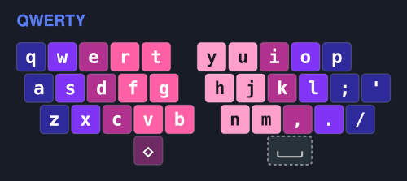
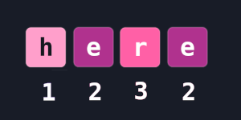
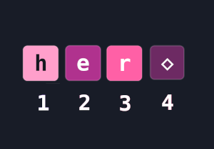

# QMK Skip Repeat
A modern implementation of skip repeat for QMK.

##### Skip Repeat
Repeats the second last character.

## Why?

Skip repeat is a concept popularized by the [Alternate Keyboard Layouts](https://discord.gg/pjhz8QtjE2) discord.  
Layout authors include it to increase the efficiency of inputs.
  

## Skip Repeat

This is QWERTY's keymap. Let's place our skip repeat key on left thumb, represented by `◇`.  
&nbsp;  
Imagine we want to type the word `here`.  
Without skip repeat we'd type it like this:  

  
Notice how we use the `2` finger multiple times, reducing our speed.  
&nbsp;  
With skip repeat we instead press `◇` for the second `e`:  

  
&nbsp;  
We can now remap every skip repeated character to `◇`, improving our speed and reducing strain.

## Usage

1. Copy `skip_repeat.h` and the `example` folder to your keyboard's keymap directory.
For example: `qmk_firmware/keyboards/<keyboard brand>/<keyboard name>/<keyboard version>/keymaps`

2. Create a keymap using QMK's [Configurator](https://config.qmk.fm).  

3. Apply the ANY function to a key.  
Paste `KC_SKIP_REPEAT` into the ANY key's text field. 

5. Download `keymap.json` to the `example` folder we copied.
  
6. Convert the keymap to code.  
`qmk json2c keymap.json >> keymap.c`  
This adds the keymap to our existing `keymap.c`.

7. Flash your firmware.  
`qmk flash -kb <your keyboard> -km example`

